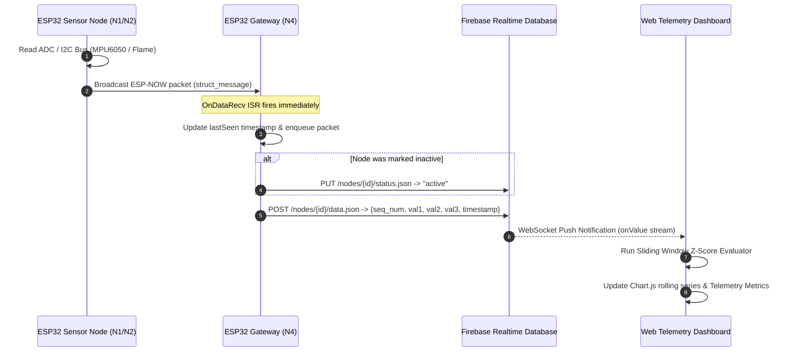

# Distributed Wireless Sensor Network (WSN) with Real-Time Cloud Telemetry

[](https://www.espressif.com/)
[](https://docs.espressif.com/projects/esp-idf/en/latest/esp32/api-reference/network/esp_now.html)
[](https://firebase.google.com/)
[](https://www.chartjs.org/)
[](./LICENSE)

A high-performance, low-latency **Wireless Sensor Network (WSN)** telemetry pipeline built with Espressif **ESP32** microcontrollers, **ESP-NOW** peer-to-peer radio protocol, a dual-radio **Central Gateway**, **Google Firebase Realtime Database (RTDB)**, and a cyber-dark **Live Web Dashboard** equipped with real-time sliding-window **Z-score anomaly detection**.

---

## 📑 Table of Contents

- [System Overview](#-system-overview)
- [Architecture & Data Pipeline](#-architecture--data-pipeline)
- [Hardware & Sensor Nodes](#-hardware--sensor-nodes)
  - [Node 1 (N1) — Vibration Sensor Node](#node-1-n1--vibration-sensor-node)
  - [Node 2 (N2) — Optical Flame Sensor Node](#node-2-n2--optical-flame-sensor-node)
  - [Node 3 (N3) — Power Grid Monitoring Node](#node-3-n3--power-grid-monitoring-node)
  - [Node 4 (N4) — Central Gateway Node](#node-4-n4--central-gateway-node)
- [Network Protocol & Packet Structure](#-network-protocol--packet-structure)
- [Cloud Architecture & Database Schema](#-cloud-architecture--database-schema)
- [Web Telemetry Dashboard](#-web-telemetry-dashboard)
  - [Key Features](#key-features)
  - [Sliding-Window Z-Score Anomaly Detection](#sliding-window-z-score-anomaly-detection)
- [Security & Environment Variables](#-security--environment-variables)
- [Repository Structure](#-repository-structure)
- [Getting Started & Installation](#-getting-started--installation)
  - [1. Arduino IDE / Hardware Setup](#1-arduino-ide--hardware-setup)
  - [2. Central Gateway (N4) Deployment](#2-central-gateway-n4-deployment)
  - [3. Sensor Nodes (N1, N2) Deployment](#3-sensor-nodes-n1-n2-deployment)
  - [4. Web Dashboard Configuration](#4-web-dashboard-configuration)
- [Troubleshooting & Best Practices](#-troubleshooting--best-practices)
- [License & Credits](#-license--credits)

---

## 🔭 System Overview

This project implements an end-to-end industrial IoT telemetry pipeline engineered for high-frequency sensor acquisition and mission-critical environmental monitoring.

```
┌─────────────────┐       ┌─────────────────┐       ┌─────────────────┐
│ Node 1 (MPU6050)│       │ Node 2 (Flame)  │       │ Node 3 (Voltage)│
│  Vibration IMU  │       │  Optical Fire   │       │  AC Power Grid  │
└────────┬────────┘       └────────┬────────┘       └────────┬────────┘
         │                         │                         │
         │ ESP-NOW (2.4 GHz)       │ ESP-NOW (2.4 GHz)       │ ESP-NOW (2.4 GHz)
         └─────────────────────────┼─────────────────────────┘
                                   │
                                   ▼
                      ┌─────────────────────────┐
                      │  Node 4: Central Gateway│
                      │   ESP32 (Dual-Radio)    │
                      │  ESP-NOW + Wi-Fi Client │
                      └────────────┬────────────┘
                                   │
                                   │ HTTPS REST (JSON Payload)
                                   ▼
                      ┌─────────────────────────┐
                      │    Firebase Realtime    │
                      │     Cloud Database      │
                      └────────────┬────────────┘
                                   │
                                   │ WebSockets (Live Push / limitToLast:30)
                                   ▼
                      ┌─────────────────────────┐
                      │  Telemetry Web Console  │
                      │    Chart.js + Z-Score   │
                      │    Anomaly Detection    │
                      └─────────────────────────┘
```

- **Low-Latency Transmission**: Edge sensor nodes bypass traditional Wi-Fi connection handshakes by leveraging connectionless **ESP-NOW** datagram packets.
- **Reliable Central Ingestion**: The gateway coordinates simultaneous ESP-NOW reception and Wi-Fi uplink, executing non-blocking queue ingestion to Firebase RTDB.
- **Liveness Monitoring**: The gateway runs an autonomous hardware heartbeat watchdog (`5000 ms` timeout) that sets nodes active or inactive in the cloud dynamically.
- **Client-Side Edge Analytics**: The web frontend performs real-time parametric statistical surveillance (Z-Score algorithm) over incoming telemetry streams.

---

## ⚡ Architecture & Data Pipeline



---

## 🎛 Hardware & Sensor Nodes

### Node 1 (N1) — Vibration Sensor Node
- **Microcontroller**: ESP32 DevKit V1
- **Sensor**: Adafruit MPU-6050 6-Axis Motion Tracking Sensor (Accelerometer + Gyroscope)
- **Interface**: I2C (`SDA` -> `GPIO 21`, `SCL` -> `GPIO 22`)
- **Telemetry Measured**:
  - `val1`: Accelerometer X-axis ($m/s^2$ / $g$)
  - `val2`: Accelerometer Y-axis ($m/s^2$ / $g$)
  - `val3`: Accelerometer Z-axis ($m/s^2$ / $g$)
- **Sampling Frequency**: $2\text{ Hz}$ (every 500 ms) with automatic I2C re-handshake on fault.

| Pin (ESP32) | Pin (MPU-6050) | Description |
|:---:|:---:|:---|
| `3V3` / `VIN` | `VCC` | 3.3V Power Supply |
| `GND` | `GND` | Common Ground |
| `GPIO 21` | `SDA` | I2C Serial Data |
| `GPIO 22` | `SCL` | I2C Serial Clock |

---

### Node 2 (N2) — Optical Flame Sensor Node
- **Microcontroller**: ESP32 DevKit V1
- **Sensor**: Infrared Optical Flame Detection Sensor Module
- **Interface**: Mixed Analog (AO) + Digital (DO)
  - `GPIO 32` -> Analog AO (Analog-to-Digital continuous voltage reading)
  - `GPIO 16` -> Digital DO (Threshold comparator output)
- **Telemetry Measured**:
  - `val1`: Flame intensity ADC reading ($0 - 4095$)
  - `val2`: Flame threshold digital state ($0 = \text{Fire Detected}, 1 = \text{Normal}$)
  - `val3`: Reserved / Unused
- **Sampling Frequency**: $1\text{ Hz}$ (every 1000 ms).

| Pin (ESP32) | Pin (Flame Sensor) | Description |
|:---:|:---:|:---|
| `3V3` | `VCC` | 3.3V Power Supply |
| `GND` | `GND` | Ground Reference |
| `GPIO 32` | `AO` | Analog Voltage Output |
| `GPIO 16` | `DO` | Digital Logic Level Output |

---

### Node 3 (N3) — Power Grid Monitoring Node
- **Microcontroller**: ESP32 DevKit V1
- **Sensor**: AC Voltage Sensor (e.g. ZMPT101B Precision Voltage Transformer)
- **Nominal Target**: 220V AC Power Line Telemetry
- **Telemetry Measured**:
  - `val1`: RMS Voltage measurement
- **Status**: Extensible sensor node profile configured inside `node-card.js`.

---

### Node 4 (N4) — Central Gateway Node
- **Microcontroller**: ESP32 Dual-Radio Gateway
- **Roles & Responsibilities**:
  1. **ESP-NOW Server**: Listens on locked Wi-Fi Channel matching sensor nodes.
  2. **Decoupled Buffer Queue**: Uses independent `NodeTracker` structs per node so high-frequency packets are never dropped during network delays.
  3. **Node Health & Liveness Watchdog**:
     ```cpp
     if (millis() - nodes[i].lastSeen > NODE_TIMEOUT_MS) {
       nodes[i].isActive = false;
       setNodeStatus(nodes[i].nodeId, "", false);
     }
     ```
     If a node stops emitting packets for $> 5000\text{ ms}$, the gateway marks its status as `"inactive"` in Firebase.
  4. **Wi-Fi Watchdog**: Auto-reconnects to the wireless access point if connectivity drops.
  5. **Secure Cloud Ingestion**: Posts reading objects via HTTPS REST to Firebase RTDB.

---

## 📡 Network Protocol & Packet Structure

All sensor nodes communicate with the central gateway using a packed C-struct over ESP-NOW:

```cpp
typedef struct struct_message {
  char node_id[4];      // Identifier: "N1", "N2", "N3"
  char sensor_type[10];  // Sensor name: "vibration", "flame", etc.
  float val1;           // Primary sensor value (e.g. Accel X, Flame AO)
  float val2;           // Secondary value (e.g. Accel Y, Flame DO)
  float val3;           // Tertiary value (e.g. Accel Z)
  int seq_num;          // Monotonically increasing packet sequence ID
} struct_message;
```

### Packet Guarantees:
- **Packet Size**: Fixed 28 bytes per datagram (minimal airtime overhead).
- **Channel Synchronization**: The gateway operates on a fixed Wi-Fi channel; all sensor nodes lock to `esp_wifi_set_channel(N4_CHANNEL, WIFI_SECOND_CHAN_NONE)`.

---

## ☁ Cloud Architecture & Database Schema

The system uses **Firebase Realtime Database (RTDB)** with a structured NoSQL tree:

```json
{
  "nodes": {
    "N1": {
      "status": "active",
      "sensor_type": "vibration",
      "data": {
        "-O4xK...": {
          "seq_num": 104,
          "timestamp": 128450,
          "val1": 0.12,
          "val2": -0.04,
          "val3": 9.81
        }
      }
    },
    "N2": {
      "status": "active",
      "sensor_type": "flame",
      "data": {
        "-O4xL...": {
          "seq_num": 42,
          "timestamp": 129000,
          "val1": 3410.0,
          "val2": 1.0,
          "val3": 0.0
        }
      }
    }
  }
}
```

---

## 🖥 Web Telemetry Dashboard

The web dashboard is an industrial-grade, cyber-dark console located in the `dashboard/` directory.

### Key Features
- **Modern Glassmorphism Aesthetic**: Custom-styled with high-contrast glowing indicators (`cyan`, `green`, `amber`, `purple`), backdrop blur filters, and clean typography (`Inter` & `JetBrains Mono`).
- **Dynamic Node Cards**: Automatically binds to incoming node telemetry streams, rendering individual cards for `N1`, `N2`, and `N3`.
- **Live Time-Series Graphs**: Powered by **Chart.js**, rendering rolling datasets with smooth cubic interpolation curves and glowing fill gradients.
- **Real-Time Counters**: Global active node counter (`active-count`), total ingested packets counter (`total-packets`), and node health badges (`ACTIVE`, `INACTIVE`, `ANOMALY`).

---

### Sliding-Window Z-Score Anomaly Detection

Built directly into `dashboard/node-card.js` is an industrial-standard rolling window anomaly detection engine:

$$\mu = \frac{1}{W} \sum_{i=1}^W x_i \qquad \sigma = \sqrt{\frac{1}{W} \sum_{i=1}^W (x_i - \mu)^2}$$

$$\text{Anomaly Threshold} = \mu + Z \cdot \max(\sigma, 0.05 \cdot \mu, 0.01)$$

#### Algorithmic Mechanism:
1. **Window Size ($W = 30$)**: Maintains a rolling historical buffer of the past 30 magnitude values.
2. **Dynamic Baseline**: Recomputes rolling mean ($\mu$) and standard deviation ($\sigma$) with every packet.
3. **Threshold Breaches**: Readings exceeding $\mu + 2\sigma$ increment a consecutive breach counter.
4. **Hysteresis & State Escalation**:
   - **`NORMAL`**: Standard operation.
   - **`WARNING`**: Triggered upon $\ge 5$ consecutive breaches.
   - **`ALERT`**: Triggered upon $\ge 10$ consecutive breaches.
5. **Decay Buffer**: When values normalize, the counter gradually decays rather than instantly clearing, preventing state flicker from intermittent noise.

---

## 🔒 Security & Environment Variables

All sensitive Firebase API credentials have been decoupled from source code into environment variables.

### Configuration Files:
- **`dashboard/.env`**: Contains production project keys (protected by `.gitignore`).
- **`dashboard/.env.example`**: Clean template safe for version control.

```env
# Firebase Web App Credentials
FIREBASE_API_KEY="AIzaSy..."
FIREBASE_AUTH_DOMAIN="wsn-project-bb012.firebaseapp.com"
FIREBASE_DATABASE_URL="https://wsn-project-bb012-default-rtdb.asia-southeast1.firebasedatabase.app"
FIREBASE_PROJECT_ID="wsn-project-bb012"
FIREBASE_STORAGE_BUCKET="wsn-project-bb012.firebasestorage.app"
FIREBASE_MESSAGING_SENDER_ID="805607252"
FIREBASE_APP_ID="1:805607252:web:..."
```

### Configuration in `firebase-config.js`:
The client configuration module initializes Firebase cleanly and reliably:
1. Inspects bundler variables (`import.meta.env` or `VITE_` prefix) if compiled with Vite.
2. Inspects runtime globals (`window.__ENV__`) if injected by a container or reverse proxy.
3. Falls back to pre-configured project credentials (`DEFAULT_CONFIG`) so it works immediately with VS Code Live Server, Python `http.server`, or static hosts without dotfile/404 issues.
4. Validates configuration integrity and monitors RTDB connection state via `.info/connected`.

---

## 📁 Repository Structure

```
WSN/
│
├── .gitignore                         # Protects .env, build files, and secrets
├── LICENSE                            # MIT License
├── README.md                          # Comprehensive project documentation
│
├── arduino codes/                     # Microcontroller firmware source code
│   ├── central_node/
│   │   └── central_node.ino           # Gateway Node (N4) firmware: ESP-NOW + Wi-Fi + Firebase
│   │
│   ├── flame_sensor/
│   │   └── flame_sensor.ino           # Sensor Node 2 (N2) firmware: Flame sensor transmitter
│   │
│   └── vibration_sensor/
│       └── vibration_sensor.ino       # Sensor Node 1 (N1) firmware: MPU6050 vibration transmitter
│
└── dashboard/                         # Real-time Web Telemetry Application
    ├── .env                           # Local Firebase credentials (NEVER commit!)
    ├── .env.example                   # Environment configuration template
    ├── .gitignore                     # Local dashboard environment ignore rules
    ├── index.html                     # Telemetry console layout & markup
    ├── styles.css                     # Glassmorphism cyber-dark UI theme
    ├── dashboard.js                   # Application coordinator & Firebase subscribers
    ├── node-card.js                   # Card generator, Chart.js manager & Z-score detector
    └── firebase-config.js             # Environment-aware Firebase SDK initializer
```

---

## 🚀 Getting Started & Installation

### 1. Arduino IDE / Hardware Setup

1. Open **Arduino IDE** (v2.0+ recommended).
2. Install the **ESP32 Board Package**:
   - Go to `File` > `Preferences` > `Additional Board Manager URLs`.
   - Add: `https://raw.githubusercontent.com/espressif/arduino-esp32/gh-pages/package_esp32_index.json`
   - Go to `Tools` > `Board` > `Boards Manager...` and install **esp32** by Espressif Systems.
3. Install the required libraries via `Sketch` > `Include Library` > `Manage Libraries...`:
   - **Adafruit MPU6050**
   - **Adafruit Unified Sensor**
   - **Adafruit BusIO**

---

### 2. Central Gateway (N4) Deployment

1. Open `arduino codes/central_node/central_node.ino`.
2. Configure your Wi-Fi credentials and Firebase endpoint:
   ```cpp
   const char* ssid = "YOUR_WIFI_SSID";
   const char* password = "YOUR_WIFI_PASSWORD";
   const char* firebaseHost = "https://YOUR_PROJECT-default-rtdb.firebaseio.com";
   ```
3. Connect the Gateway ESP32 via USB.
4. Select board **ESP32 Dev Module** and the proper COM port.
5. Upload the code and open the **Serial Monitor** at `115200` baud.
6. Note the MAC address and Wi-Fi Channel printed in the serial terminal:
   ```
   [WiFi] CONNECTED
   [WiFi] Channel: 11
   MAC Address: 8C:94:DF:7C:3F:58
   ```

---

### 3. Sensor Nodes (N1, N2) Deployment

1. In both `flame_sensor.ino` and `vibration_sensor.ino`:
   - Set `receiverMAC` to your Gateway's MAC address:
     ```cpp
     uint8_t receiverMAC[] = {0x8C, 0x94, 0xDF, 0x7C, 0x3F, 0x58};
     ```
   - Set `N4_CHANNEL` to match the Gateway's Wi-Fi channel:
     ```cpp
     #define N4_CHANNEL 11
     ```
2. Connect each sensor node to your PC and upload the respective `.ino` sketch.
3. Verify via the Serial Monitor that transmissions return:
   ```
   Send status: SUCCESS
   ```

---

### 4. Web Dashboard Configuration

Because the dashboard uses ES Modules and dynamically loads `.env`, serve it through a local HTTP server:

#### Option A: Using VS Code Live Server (Fastest)
1. Install the **Live Server** extension in VS Code.
2. Right-click `dashboard/index.html` and click **"Open with Live Server"**.
3. Open `http://127.0.0.1:5500/dashboard/index.html`.

#### Option B: Using Node.js `npx serve`
```bash
cd dashboard
npx serve .
```

#### Option C: Using Python HTTP Server
```bash
cd dashboard
python -m http.server 8080
```
Navigate to `http://localhost:8080` in your web browser.

---

## 🛠 Troubleshooting & Best Practices

| Symptom | Probable Cause | Recommended Resolution |
|:---|:---|:---|
| **`ESP-NOW Send Status: FAIL`** | Channel mismatch or incorrect gateway MAC address. | Verify gateway MAC via `WiFi.macAddress()`. Confirm sender and receiver share the identical Wi-Fi channel (`esp_wifi_set_channel`). |
| **Node displays `INACTIVE`** | Sensor node stopped transmitting or power lost. | Check serial monitor of node. If last packet exceeds `5000 ms`, the gateway automatically flags node as inactive. |
| **`MPU6050 NOT FOUND!`** | Loose I2C connections or missing pull-up resistors. | Ensure `SDA` is wired to `GPIO 21`, `SCL` to `GPIO 22`, and the sensor receives stable 3.3V power. |
| **Dashboard charts not updating** | Firebase rules blocking read access or invalid `.env` values. | Ensure Firebase RTDB Security Rules permit reads: `".read": true`. Check the browser DevTools console for missing `.env` errors. |
| **CORS errors loading `.env`** | Opening `index.html` directly via `file://` protocol. | Browsers block module scripts and `fetch` under `file://`. Always launch using an HTTP server (`npx serve`, Live Server, or Python server). |

---

## 📄 License & Credits

This project is licensed under the **MIT License** — see the [LICENSE](./LICENSE) file for details.

Developed with ❤️ by **Gajula Eshwarnath**.
