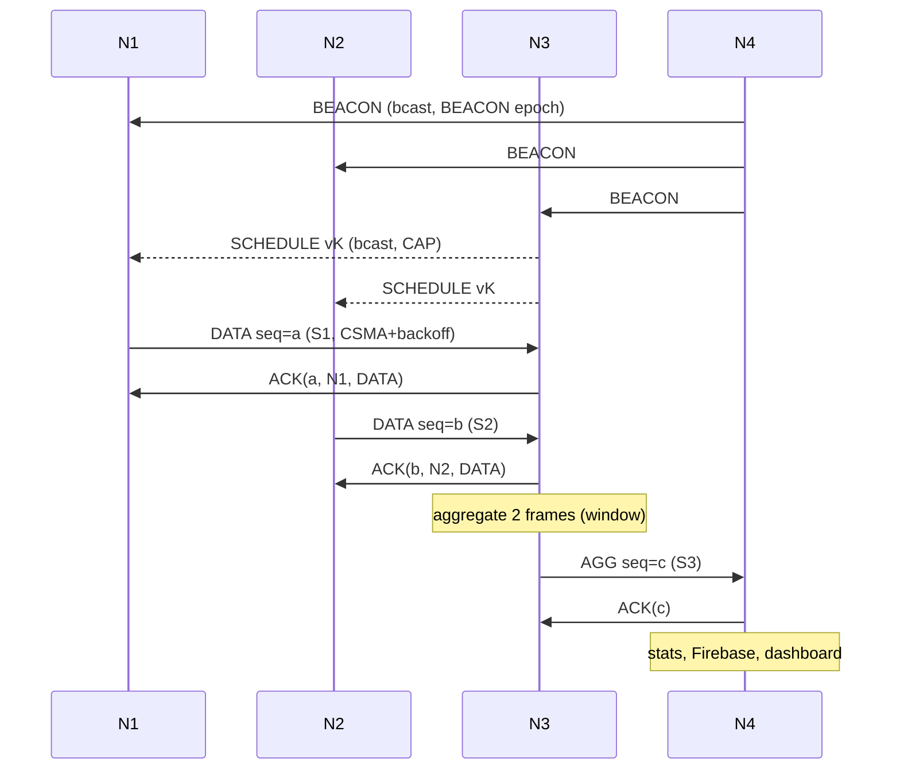

# WSN Lab Eval 2: Audit, Corrections and Test Report

**Repository:** `Eshwarnath24/WSN`, commit `65346c9`, inspected read-only
**Guidelines:** *23CSE341 WSN Lab Evaluation 2 Guidelines* (PDF)
**Date:** 2026-10-14

> **Repository not modified.** Nothing was edited, committed, pushed or merged in your GitHub repository. Every proposed file is in the scratchpad tree `proposed/`, and `PROPOSED_CHANGES.diff` holds a unified diff for review. All change statuses are **PROPOSED**; none is MANUALLY APPLIED or HARDWARE VERIFIED.

## How to read the evidence labels

| Label | Meaning |
|---|---|
| **CODE** | Read directly from the source (static inspection). |
| **HOST-BUILD** | Compiled with `g++ -Wall -Wextra` against hand-written stubs of the Arduino, ESP-IDF, ESP-NOW, NimBLE and FreeRTOS APIs. This proves C++ validity and API *shape*. It is **not** an ESP32 Xtensa build. |
| **SIM** | The four sketches run as four Linux processes over a simulated radio: UDP medium, Wi-Fi channels, injected frame loss, link cuts, BLE RSSI from a path-loss model with noise. Every RSSI, distance, localization error and timing number from SIM is **simulated, not measured**. |
| **NOT RUN** | Real ESP32 compilation, flashing and physical hardware tests. The Espressif, PlatformIO and Arduino download hosts are blocked by this cloud environment's network policy, and I have no access to your boards. |

---

## 1. Executive Summary

Your firmware is far more complete than a typical "ESP32 talks to ESP32" project:
- an ESP-NOW mesh with an application-level CSMA/ACK MAC
- TDMA superframes with beacon sync
- a cluster head that aggregates N1+N2 data
- cost-based routing
- BLE RSSI ranging with trilateration
- a Firebase dashboard

However, the audit and the baseline simulation found **7 critical defects**. Each one breaks a graded requirement during the demo:

| ID | Critical defect (original code) | Breaks |
|---|---|---|
| C1 | BLE reports from N1/N2 are **swallowed at N3** and never reach the sink. Only N3 gets localized in normal operation. | BLE localization (3 marks) |
| C2 | N3 rebroadcasts the **default** schedule every 6 s, which **overwrites every dynamic schedule** (ALERT/IDLE) within seconds. | Dynamic scheduling |
| C3 | No split horizon: after the N3–N4 link fails, N3↔N1/N2 form a **routing loop**. SIM: 42+15+1 TTL-expired drops. | Route recovery |
| C4 | `restore` never reaches N3: CTRL frames from N4 are discarded by N3's own link-kill filter. | Recovery demo |
| C5 | In normal (clustered) operation N4 posts **no per-node sensor data**; N3 is never shown "active". | Dashboard |
| C6 | PDR counts AGG constituents by sequence range, with no duplicate filtering, so it can **exceed 100% or hide losses**. Aggregated delay is recorded as **0 ms**. | Performance metrics |
| C7 | Collision-test frames (value 999) are aggregated as real N1 data. SIM: `N1_max=1730`. They corrupt seq ranges and can trigger a false N1 alert. | MAC demo, aggregation, PDR |

There are also 11 high- and 13 medium-severity issues (§22). Examples: N4's scheduler failover can never trigger; transmissions overrun their TDMA slot; there is no resync after beacon loss; the topology view is guessed; there are race conditions; and the send-callback code doesn't compile on Arduino core 3.0–3.2.

**Proposed fix:** same architecture and same files (3 shared headers, 4 sketches, dashboard), with a v2 wire protocol. In SIM, the original firmware ended the baseline failure scenario at about 62–69% PDR per node. Over the comparable 150 s scenario (collision test, vibration alert, `kill 3 4`, `restore`, N3 power-off, 2% injected loss) the proposed firmware achieved:
- **PDR 100% (442/442)**, 0 TTL drops, 0 routing loops
- dynamic schedule v1 → v2 (alert) → v3 (normal) → v32769 (N4 failover)
- 55.3% byte and 72.7% packet data reduction
- every node localized

**Readiness:** the code is **READY FOR HARDWARE TESTING**. The project is **not yet READY**: nothing has been compiled for a real ESP32 or run on your boards, and some hardware facts are unknown (§5).

---

## 2. Repository Structure and Firmware Mapping

```
arduino codes/
  common/            wsn_common.h (types/packets/constants), wsn_mesh.h (MAC/routing/TDMA), wsn_ble.h (BLE)
  node1_vibration/   node1_vibration.ino  + copies of the 3 headers   → physical N1
  node2_flame/       node2_flame.ino      + copies                     → physical N2
  node3_cluster_head/node3_cluster_head.ino + copies                   → physical N3
  node4_sink/        node4_sink.ino + copies + wsn_config.h (Wi-Fi/Firebase credentials)  → physical N4
dashboard/           index.html, dashboard.js, node-card.js, styles.css, firebase-config.js, .env.example
README.md            (describes an OLDER star-topology version; see D1)
WSN LAB EVAL 2 - GUIDELINES.pdf
```

- **Framework:** Arduino IDE sketches (CODE). There is no `platformio.ini`, CMake, test suite, CI workflow or circuit diagram in the repository.
- **Headers:** each sketch folder holds its own copy of the shared headers, found via `__has_include("wsn_common.h")`. In the original commit the 4 copies are byte-identical to `common/` (verified).
- **ESP32 core:** the code needs Arduino-ESP32 **3.x** (the receive callback uses `esp_now_recv_info_t`, IDF ≥ 5.0). The original send callback uses `wifi_tx_info_t` whenever IDF ≥ 5.0, so it only compiles on core **≥ 3.3.x** (IDF 5.5). See H9.
- **Libraries:** NimBLE-Arduino **2.x** (`NimBLEScanCallbacks` and `onScanEnd(results, reason)` are 2.x APIs), Adafruit MPU6050, Adafruit Unified Sensor, Adafruit BusIO.
- **Dashboard:** vanilla ES modules, Firebase JS SDK 10.12.0 and Chart.js 4.4.0 from CDN.
- **Board:** "ESP32 DevKit V1" per the README. The exact module (WROOM-32 vs WROVER) is not documented.
- **Node identity:** `#define MY_NODE_ID n` in each sketch. MAC addresses N1–N3 are placeholders and are **auto-learned at runtime** from received frames; this works, as confirmed in SIM. N4's MAC `8C:94:DF:7C:3F:58` is hard-coded.

---

## 3. Implemented Network Architecture

- **Radio:** ESP-NOW, which uses 802.11 vendor-specific action frames, on the Wi-Fi channel of N4's hotspot. N1–N3 scan channels 1–13 until they hear N4's beacon. BLE runs in parallel (NimBLE), with Wi-Fi/BLE coexistence.
- **Superframe (800 ms):** BEACON 0–40 | CAP 40–160 | S1 160–280 | S2 280–400 | S3 400–550 | S4 550–670 | SLEEP 670–800.
- **Default schedule:** S1 = N1 TX, S2 = N2 TX, S3 = N3 TX (aggregate), S4 = N2 RELAY.
- **Routing:** distance vector (HELLO every 2 s). Cost = hops + 2·ETX + 0.5·RSSI-norm, with a +10 penalty on N1/N2 → N4 direct while N3 is usable.
- **Data path:** N1 → N3 and N2 → N3 (DATA, unicast, ACKed). N3 consumes and aggregates them, then sends AGG → N4.
- **N4 roles:** time master (beacon), routing root (hops 0), ACKs, CTRL origin, Firebase gateway, BLE localization engine, and (in the proposed code) backup scheduler.

---

## 4. Four-Node Role and Responsibility Table

| Node | Guideline role | Original implementation (CODE) | Proposed implementation |
|---|---|---|---|
| N1 | Sensor | MPU6050, BLE adv/scan, TDMA S1, DATA → next hop, ACK/retry, can forward. **Gap:** its BLE reports are lost at N3 (C1). | Same, plus boot-time BLE discovery and local localization, retransmission carried across slots, contention test through CAP. |
| N2 | Sensor/Relay | Flame AO/DO, S2 TX, S4 RELAY slot, forwards transit packets. | Same, plus relay logging and the relay slot used for N3's AGG on alternate routes. |
| N3 | Cluster head / aggregator / router | Aggregates N1+N2, sends AGG in S3, broadcasts schedule. **Gaps:** C2, C7, H7, races. | Aggregation over a 2-frame window with exact counts and timestamps; versioned dynamic scheduler (alert, release/restore of slots); forwards BLE reports. |
| N4 | Sink/gateway | Beacon, HELLO (hops 0), ACKs, CTRL, Firebase. **Gaps:** failover scheduler unreachable (H2), wrong metrics (C6), heavy work inside the radio callback (H8). | Also backup scheduler, liveness watchdog, unique-packet metrics, real topology, schedule publication. |

**Designated role vs network participation.** N4 is not a passive receiver. It takes part in time synchronisation, route advertisement, ACKs, control broadcasts and (proposed) failover scheduling. It does not relay other nodes' sensor payloads, because it is their final destination; this is correct for a sink. The topology is a genuine multi-hop mesh: N1/N2 → N3 → N4 normally, with alternates N3 → N2 → N4, N2 → N3 → N1 → N4, and N1 → N2 → N4, all observed in SIM.

---

## 5. Hardware and GPIO Verification

**Sources:** sketches (CODE) and the README pin tables (DOC). There are no schematics or photos. **No physical inspection was possible.**

| Node | Board | Peripheral | Interface | ESP32 GPIO | Peripheral pin | Supply | Status |
|---|---|---|---|---|---|---|---|
| N1 | ESP32 DevKit V1 (DOC) | MPU6050 (GY-521?) | I2C @0x68 | 21 SDA, 22 SCL | SDA, SCL | 3V3 (DOC) | CODE = DOC ✔. Pull-ups and AD0 = GND are **UNVERIFIED**. |
| N2 | ESP32 DevKit V1 (DOC) | IR flame module (LM393) | Analog + digital | 32 (AO, ADC1_CH4), 16 (DO) | AO, DO | 3V3 (DOC) | CODE = DOC ✔. See H-1, H-2. |
| N3 | ESP32 DevKit V1 (DOC) | **IR obstacle sensor (CODE)**; the README says a **ZMPT101B AC voltage sensor** | Digital | 4 | OUT | ? | **CONFLICT (D3).** Need your confirmation. |
| N4 | ESP32 (DOC) | none | Wi-Fi STA + ESP-NOW + BLE | – | – | USB | ✔ (CODE) |

**Checks**
- **Pin choices:** GPIO 4, 16, 21, 22 and 32 are all valid inputs. None is input-only, and nothing is driven as an output. GPIO4 is *not* a strapping pin (strapping pins are 0, 2, 5, 12, 15). GPIO32 is ADC1, which keeps working while Wi-Fi is on (ADC2 does not).
- **I2C:** 21/22 are the DevKit's default I2C pins.
- **Shared pins:** no pin is shared between peripherals.
- **H-1 (UNVERIFIED, safety):** if the flame module is powered from **5 V**, its AO/DO can exceed the ESP32's 3.3 V limit. Power it from **3V3**, as the README says.
- **H-2 (UNVERIFIED):** GPIO16 is unusable on **WROVER** modules, where it is wired to PSRAM. Confirm your boards are WROOM-32 DevKits.
- **H-3:** flame AO polarity depends on the module (many read *lower* when the flame is closer). The proposed AGG therefore reports both max and min analog values. DO (0 = fire) is unambiguous.
- **H-4 (CODE):** a missing or disconnected sensor is handled. N1 re-probes the MPU6050 every 2 s without blocking (the proposed fix for M8); flame and IR are plain GPIO reads that cannot detect disconnection.
- **H-5 (build):** N4 links NimBLE, Wi-Fi, TLS and HTTPClient. If the IDE reports "Sketch too big", choose *Tools → Partition Scheme → Huge APP (3MB No OTA)*. **UNVERIFIED**: no real build was run.
- **H-6 (RF):** your phone hotspot must be **2.4 GHz**. ESP32 has no 5 GHz radio, and the hotspot channel becomes the mesh channel.

**I need from you to complete hardware verification:**
1. A photo or description of the wiring for each node.
2. The exact sensor modules (in particular **what is on N3**).
3. The supply voltage of each module.
4. The ESP32 module marking (WROOM-32 or WROVER).
5. Tape-measured node positions (for `NODE_TRUE_POS`).

**No wiring change is required by the proposed code.** All GPIOs are unchanged.

---

## 6. BLE Localization Audit

| Item | Original (CODE) | Status | Proposed |
|---|---|---|---|
| Advertising | NimBLE, manufacturer data `[0xFFFF, node_id, A = −59]`, 100–200 ms interval | IMPLEMENTED | unchanged |
| Scanning | Only in the SLEEP epoch, every 3 s; **200 ms burst > 130 ms epoch** (overlaps BEACON/CAP); active scan; results stored | PARTIAL | 100 ms passive burst that fits inside SLEEP; `setMaxResults(0)`; boot-time 1.5 s discovery before Wi-Fi (matches the guideline demo order) |
| Neighbour discovery | `mesh.ble[]` table; entries never expire | PARTIAL | 15 s expiry |
| RSSI | `getRSSI()` + EWMA (α = 0.3) | IMPLEMENTED (real measurement on hardware) | reports the filtered RSSI |
| Distance | `d = 10^((A − RSSI_f) / (10·n))`, A = −59, n = 2.2 | IMPLEMENTED; constants **need calibration** | unchanged; calibration procedure in T7/T8 |
| Nearest node | min distance | IMPLEMENTED | also printed as a proximity statement |
| Localization | Trilateration at N4 from 3 anchor distances | **INCORRECT in practice**: N1/N2 reports never reach N4 (C1) | reports forwarded multi-hop; each node also localizes itself locally and prints it |
| Localization error | `‖est − NODE_TRUE_POS[reporter]‖` | IMPLEMENTED (formula) | unchanged formula, pushed per node |
| Ground truth | `NODE_TRUE_POS` table; the dashboard used **different** positions (N3 (1, 2) vs (1, 1.5); N4 (1, 1) vs (1, −1)) | INCORRECT on dashboard | dashboard uses `true_x/true_y` sent by the firmware |

**Localization method:** each node is treated in turn as the unknown; the other three nodes, at their tape-measured reference positions, are the anchors. The error is the Euclidean distance between the estimated and reference positions. This is valid as long as you measure and enter real positions. Expect errors of the order of a metre indoors; that is normal and worth explaining in the viva.

---

## 7. Wi-Fi MAC Audit

ESP-NOW frames are already subject to the ESP32 hardware's 802.11 DCF (carrier sense and link-layer ACK/retry). That built-in behaviour does **not** satisfy the guideline by itself. The graded MAC is the **application-level** one:

| Step | Original (CODE) | Problem | Proposed |
|---|---|---|---|
| Channel sensing | Software CCA: "busy" if *any* frame was sniffed in promiscuous mode in the last 3 ms (includes AP beacons and foreign traffic) | Over-sensitive in a busy lab; nothing filtered | Only ESP-NOW action frames from known WSN peers count; MGMT-only promiscuous filter; busy if a WSN frame was sniffed **during** the backoff |
| Random backoff | Only when CCA was busy or after a timeout (CW 4 → 64 × 5 ms = up to 320 ms) | Normal sends show no backoff; a 320 ms backoff overruns 120 ms slots | Always: sense → random backoff [0, CW−1] × 2 ms → re-sense → TX. BEB CW 4 → 16 |
| ACK | Matched on (seq, origin) | Seq collisions between DATA and BLE_RPT (separate counters, same origin) | Matched on (seq, origin, **type**, **sender**) |
| Timeout / retransmit | 80 ms × up to 4 attempts, blocking, ignores slot end | Spills into other nodes' slots | 60 ms; each attempt must fit before the slot/CAP end, otherwise **DEFER** to the next own slot or CAP, keeping the attempt count |
| Retry limit | 4 attempts | ✔ | 4 attempts; link declared dead after 4 consecutive timeouts, then the packet is **re-routed** via the alternate next hop |
| Duplicates | None (an ACK lost → retransmission → processed twice) | Inflated counts | 32-entry (type, origin, seq) cache: re-ACK but don't re-process |
| Contention demo | `collision` → N1 + N2 send immediately (arbitrary epoch) | Test frames polluted aggregation (C7) | Both wait for the **start of the next CAP** and contend; test frames are sequenced, forwarded unaggregated, counted in PDR and excluded from charts |

**SIM evidence (proposed), contention at CAP start:**
```
N1: [COLLISION TEST] CAP start (synced t=40) — contending for the channel now
N1: [MAC] CSMA DATA seq=29 → N3 attempt 1/4: channel IDLE
N1: [MAC] Backoff: CW=4 slots=2 wait=4 ms
N1: [TX] type=DATA src=N1 dst=N3 ... len=41        → [MAC] ACK OK seq=29 from N3
N2: [MAC] CSMA DATA seq=29 → N3 attempt 1/4: channel IDLE
N2: [MAC] Backoff: CW=4 slots=1 wait=2 ms
N2: [MAC] CCA: BUSY (WSN frame sniffed 2 ms ago)
N2: [MAC] Contention: channel taken during backoff → defer seq=29 (CW doubles)
N2: [MAC] DEFER seq=29: 83 ms left in CAP < 92 ms needed → continue in next slot/CAP
N4: [SINK] DATA from N2: ... sensor=colltest seq=30 ... route=N2→N3→N4      (delivered later)
```
*(This excerpt comes from two SIM runs; the frame that loses contention is retried and delivered.)*

**How to show "two nodes at the same time" on hardware:** type `collision` on N4's serial console. Watch N1 and N2 side by side: one shows `channel IDLE → TX → ACK OK`, the other `CCA: BUSY … Contention … defer` or `Backoff: CW=8/16`, followed by a later delivery. Repeat it 5–10 times; the winner varies because the backoff is random. **Caveat (UNVERIFIED):** detecting the other node's frame relies on ESP32 promiscuous mode delivering ESP-NOW action frames. If the boards never log `CCA: BUSY` during this test, the random backoff still separates the transmissions, and the hardware DCF handles any overlap. Explain that in the viva.

---

## 8. Broadcast and Unicast Audit

| Message | Src → Dst | Cast | ACK | Failure behaviour | Function (proposed) |
|---|---|---|---|---|---|
| BEACON | N4 → all | Broadcast, BEACON epoch | no | nodes keep sync; HELLO-based multi-hop sync; rescan after 8 s with nothing | `tdma_send_beacon`, `mesh_handle_beacon` |
| HELLO | each → all | Broadcast, CAP | no | HELLO timeout 12 s → link DEAD | `routing_send_hello`, `mesh_handle_hello` |
| SCHEDULE | N3 (N4 in failover) → all | Broadcast, CAP, versioned | no | re-announced every 4 s | `tdma_announce_schedule`, `tdma_apply_schedule` |
| ROUTE_UPDATE | detector → all | Broadcast, CAP | no | – | `routing_queue_route_update` |
| CTRL | N4 → all | Broadcast ×3, dedup by seq | no | – | `broadcastCtrl`, `mesh_handle_ctrl` |
| DATA | N1/N2 → next hop | Unicast | yes (app ACK) | retransmit / defer / re-route / drop | `mesh_build_sensor_packet`, `mesh_own_tx_service` |
| AGG | N3 → next hop → N4 | Unicast | yes | same | `agg_send_window`, `mesh_build_agg_packet` |
| BLE_REPORT | each → next hop → N4 | Unicast, CAP | yes | same; **forwarded** at intermediate hops (C1 fix) | `mesh_handle_ble_report` |
| ACK | receiver → sender | Unicast, immediate | – | sender times out | `mac_send_ack` |

**Original-code addressing defects:** BLE_REPORT was not forwarded (C1). CTRL was blocked by the kill filter (C4). All frames were fixed at 82 bytes regardless of payload, so no receiver validated `payload_len`. **Proposed:** the header carries a magic byte, frames are variable length (header 19 B + payload), and receivers validate magic, length, `payload_len` and minimum size per message type.

---

## 9. Dynamic Scheduling Audit

| Question | Original | Proposed |
|---|---|---|
| Initial schedule / coordinator | N3, default table | N3, version 1 "INIT" |
| Distribution | Raw broadcast at arbitrary times + default refresh every 6 s | Broadcast in CAP; the *current* schedule is re-announced every 4 s |
| Slot boundaries | `synced_time % 800` | same; frame number = `synced_time / 800` (identical on all nodes) |
| TX outside slot prevented? | Partly: BLE reports, retries and forwards ignore slots (H3) | Own data only in own slot (or CAP if unscheduled); retries in slot or CAP; forwards in RELAY slot or CAP; control in CAP |
| Clock drift | Beacon every frame; beacon not aligned to frame start (H4) | Beacon at the BEACON epoch; drift correction logged every 25 frames; multi-hop sync via HELLO when the beacon is stale |
| Unused slots | Not handled | Released slots marked UNUSED; empty own slots logged `[TDMA] Sx unused (...) → radio idle`; N3's S3 idle on alternate frames (2-frame aggregation window) |
| Sleep | `esp_wifi_set_ps()` toggled. Modem sleep doesn't apply without an AP association, and Wi-Fi/BT coexistence constrains it, so this is effectively **no sleep** | **Logical radio sleep:** no Wi-Fi TX in SLEEP or idle epochs; per-node duty-cycle accounting (active vs idle epochs) reported to N4; optional real light sleep for N1 behind `WSN_ENABLE_LIGHT_SLEEP` (default off, **UNVERIFIED**) |
| Update triggers | N1 anomaly / N2 idle, but **overwritten within ≤ 6 s by the default refresh (C2)**; alert detection depended on phase (H7) | ① N1 vibration alert → S4 becomes an extra N1 TX slot (held 10 s); ② node offline (HELLO timeout) → its slot is released; ③ node back → slot restored; ④ N3 silent 10 s → **N4 takes over** (S3 UNUSED) |
| Stale / conflicting schedules | None | Versioned; an N3 schedule always wins; N4's failover schedule is only accepted when nothing has been heard from N3 for 10 s |

**SIM evidence (proposed):**
```
[TDMA] *** Schedule update v2: ALERT: N1 extra slot S4 ***
[TDMA] Schedule v2 from N3 applied (ALERT: N1 extra slot S4): S1=N1:TX S2=N2:TX S3=N3:TX S4=N1:TX
[TDMA] *** Schedule update v3: NORMAL: alert cleared ***
[N4] *** N3 silent for 10070 ms — N4 takes over TDMA scheduling ***
[TDMA] Schedule v32769 from N4 applied (FAILOVER: N3 offline): S1=N1:TX S2=N2:TX S3=UNUSED S4=N2:RELAY
[TDMA] *** Schedule update v2: RELEASE: N1 offline ***      (radio-level N1–N3 link cut)
[TDMA] *** Schedule update v3: RESTORE: N1 back ***
```

**Why the schedule changes (for the viva):**
- A vibration anomaly makes N1's data more urgent, so it gets twice the TX opportunities.
- An absent node's slot is wasted airtime, so it is released.
- The coordinator itself can fail, so the sink takes over.

---

## 10. Aggregation Audit

| Check | Original | Proposed |
|---|---|---|
| N1, N2 → N3 delivery | ✔ (DATA consumed in `app_on_data_transit`) | ✔ |
| Validation / duplicates | None. Retransmissions are aggregated twice. | Dedup before aggregation; structural validation |
| Function | N1: mean x, y, z + max \|a\|; N2: max analog, fire if any DO = 0; N3: latest IR | Same, plus N2 **min** analog, exact **counts**, oldest **origin timestamps** |
| Window | 1 superframe | `AGG_WINDOW_FRAMES = 2` (1.6 s); flushed early on an anomaly or a nearly full buffer |
| Missing readings | Fields left 0 with no indication | `n1_count` / `n2_count`; the dashboard shows "no N1 data in window" |
| Test frames | Aggregated (C7) | Forwarded individually |
| Buffer full | Silently discarded *after* ACKing | Forwarded individually |
| Race | Callback appends while loop resets | `portMUX` critical sections |
| Reduction | `(1 − 38 / payload_in)` per window. The 82-byte fixed frame made it fictional: 2 × 22 B → 38 B gives "13.6%", while airtime was 2 × 82 B → 82 B. | Variable-length frames, so byte reduction is on **actual wire bytes**. Reported per window, cumulative bytes and cumulative packets. |

**SIM (proposed):** each window aggregates 4 DATA frames, 4 × 41 B = 164 B, into 1 AGG frame of 67 B (19 B header + 48 B payload), a 59.1% byte reduction. Across the run the cumulative reduction was **55.3% bytes / 72.7% packets**.

**Formulas:**
- Bytes: `(Σ wire_in − Σ wire_out) / Σ wire_in`
- Packets: `(Σ pkts_in − Σ pkts_out) / Σ pkts_in`

Both are computed from runtime counters, not hard-coded.

---

## 11. Multi-Hop Routing Audit

**Metrics actually used (CODE):** hop count, ETX = 1/ACK-success (EWMA), Wi-Fi RSSI from `rx_ctrl`, link availability (HELLO timeout / ACK failures), plus a cluster preference.

| Question | Answer (proposed; original differences noted) |
|---|---|
| N1 → N4 | N1 → N3 → N4 (DATA aggregated at N3). Alternates: N1 → N4 direct, or N1 → N2 → … |
| N2 → N4 | N2 → N3 → N4. Alternates: N2 → N4, or N2 → N3 → N1 → N4 |
| Next-hop selection | Dynamic, least cost over the neighbour table. Not hard-coded, apart from the +10 cluster preference. |
| Loop avoidance | Original: **none** (C3). Proposed: poison reverse (HELLO carries `next_hop`), triggered HELLOs on route change, path-trace loop guard, refusal to send back to the previous hop, TTL |
| N4 participation | Advertises hops 0, sends beacons, ACKs, CTRL; backup scheduler |
| Next hop unavailable | ACK-timeout or HELLO-timeout detection → route update broadcast → recompute → in-flight packet re-routed |

**SIM after `kill 3 4`:** no loops (0 TTL drops vs 58 in the original). Converged routes: N1 → N4; N2 → N3 → N1 → N4; AGG route `N3→N1→N4` (15 AGGs delivered via this path). A second run converged on N3 → N2 → N4 instead.

---

## 12. Route Failure and Recovery Audit

| Step | Original | Proposed (SIM evidence) |
|---|---|---|
| 1. Link failure | Software `kill` (CTRL) or node power-off | Same, and also tested with a **radio-level cut** of the N1–N3 link in the simulated medium |
| 2. Detection | 3 consecutive *dropped packets* (≈ 12 timeouts), or HELLO timeout 12 s | 4 consecutive ACK timeouts (≈ 1 s), or HELLO timeout 12 s: `*** Link N1→N3 DEAD (consecutive ACK timeouts) — failure detected ***` |
| 3. Route update | Broadcast ROUTE_UPDATE + recompute | Same (sent in CAP) + triggered HELLO (poison reverse) |
| 4. Alternate route | Count-to-infinity loops (C3) | `[ROUTE] Next hop changed: N3 → N4` |
| 5. Delivery via alternate | Next packets only; the in-flight packet is lost | In-flight packet re-routed (`Re-routing seq=159 … via ALTERNATE next hop N4`). The sink confirms with `route=N1→N4` and per-origin PDR 100%. |
| Restore | Broken for N3 (C4) | `[ROUTE] Link N3↔N4 UP` → `Next hop changed: N1 → N4` |

**Failure types:**
- `kill A B` is **software failure injection**: frames from that neighbour are dropped.
- Unplugging N3 is a **real node failure**.
- Moving a node out of range, or shielding it, would be a **real link failure**.

A log line on its own does not prove recovery. Delivery must be confirmed by N4's `[SINK] … route=…` line and the PDR counters.

---

## 13. Performance Metrics Audit

| Metric | Original (CODE) | Problem | Proposed formula (`node4_sink.ino`) |
|---|---|---|---|
| PDR | `received / (highest − first + 1)` | AGG constituents counted by seq range → over-count; no dedup | Same denominator, numerator = **unique** readings (exact AGG counts), capped at expected |
| Packet loss | `expected − received` | Inherits PDR errors | `expected − unique_rx`, also as % |
| End-to-end delay | `sink_synced_now − origin_ts` for DATA only, clamped to [1, 5000] ms | **0 for aggregated data**, which diluted the average | DATA: same; AGG: N3 delay, plus N1/N2 delay from their **oldest** reading in the window (an upper bound) |
| Throughput | `Σ sizeof(wsn_packet_t) × 8 / Δt` over all deliveries (incl. BLE, duplicates) | Fixed 82 B; duplicates included | `Σ unique DATA/AGG wire bytes × 8 / Δt` (kbit/s); goodput uses payload bytes |
| Retransmissions | `total_retries` (includes CCA-busy skips and send failures) | Mixed semantics | Attempts beyond the first, per node via HELLO; network sum at N4 |
| Localization error | Euclidean distance at N4 | Only N3 reached N4 | All nodes; average error pushed |
| Data reduction | Per-window payload ratio | See §10 | Bytes and packets, window and cumulative |

All of these are runtime counters, with no hard-coded values, and they reach the dashboard.

**Clock assumption for delay:** every node's timestamp uses N4's clock via beacon sync. The beacon's one-way latency (a few ms) is not compensated, so delays carry an error of a few ms.

**SIM results** (simulated radio, **not** lab measurements):

| Run | PDR | Loss | Avg delay | Throughput | Retransmissions | Reduction | Avg loc. error |
|---|---|---|---|---|---|---|---|
| Original, baseline failure scenario, 2% loss | N1 67.1%, N2 64.2%, N3 68.7% | 32–35% | N2/N3 "0 ms" (wrong) | n/a | n/a | "13.6%" | N3 only |
| Proposed, full scenario (150 s), 2% loss | **100% (442/442)** | 0% | 422 ms (N3 37 ms; N1/N2 include the 1.6 s window) | 0.853 kbit/s | 25 | 55.3% B / 72.7% pkts | 0.44 m |
| Proposed, N1–N3 radio cut (85 s), 2% loss | 100% (all nodes) | 0% | – | – | – | – | – |
| Proposed, 10% loss (60 s) | 100% (153/153) | 0% | 703 ms | 0.322 kbit/s | 36 (39 RETRANSMIT log lines) | 57.4% / 73.9% | 0.37 m |
| Original, 10% loss (60 s) | **105.0% / 112.7% / 112.3%** (impossible: C6) | – | **0 ms** (H1) | n/a | n/a | "13.6%" | N3 only |

---

## 14. Dashboard Audit

**Original (verified by a jsdom replay of the Firebase writes recorded from the original N4 in SIM, at t = 60 s):**
- Active nodes 2/3; N3 never active.
- N1 and N2 charts hold **1 point each**, from the unsynced boot phase only.
- Avg RSSI and delay show "—" (fields never sent).
- N1 and N2 BLE positions are empty.
- Topology is guessed from N4's own link table: after `kill 3 4` it showed "N1→N4, N2→N4", which was not the actual route.
- The "Query status" button does nothing on N4.
- Node status never returns to inactive.
- BLE reference positions don't match the firmware.

**Proposed (same replay method, t = 60 s / 88 s / end):**
- Active 3/3, 29 chart points per node.
- PDR, loss, RSSI, E2E delay, throughput and retransmissions shown per node.
- New MAC-activity and duty-cycle-per-node cards.
- Live topology drawn from HELLO next hops, falling back to observed hop traces.
- TDMA schedule card (v2 ALERT → v3 NORMAL → v32769 FAILOVER).
- BLE: 4/4 nodes localized with reference positions from the firmware.
- Aggregation card: cumulative / window / packet reduction.
- Gateway freshness indicator (ONLINE, or STALE after 15 s without updates).

**This test also caught a bug in my own dashboard draft** (a temporal-dead-zone `ReferenceError`), which is fixed.

**Not verified:** visual layout in a real browser, Chart.js rendering, the real Firebase SDK, and your RTDB security rules.

---

## 15–18. Actual Code Output per Node (ORIGINAL code)

These outputs come from running your original code in SIM, using exact print strings. Values are simulated.

**N1 (original)**
```
===== NODE 1 (Vibration Sensor) BOOTING =====
[SENSOR] MPU6050 initialized                     ← mpu.begin() ok ("[SENSOR] MPU6050 NOT FOUND" otherwise)
[BLE] Initialized: WSN_N1 (TX power at 1m = -59 dBm, n = 2.2)
[MESH] Initialized: N1 (Sensor)
[MESH] MAC: AA:BB:CC:DD:EE:01                    ← prints the PLACEHOLDER table entry, not the real MAC
===== N1 SETUP COMPLETE =====
[MESH] Scanning Wi-Fi Channel 2 for N4 beacon...  ← every 1.2 s until a beacon is heard
[MESH] Auto-learned MAC for N3: 24:0A:C4:00:00:03
[ROUTE] Link N1↔N3 RESTORED (HELLO received, RSSI=-46)
[ROUTE] WARNING: No route to sink!
[TDMA] Schedule received (4 slots): REVERT: normal schedule
[TDMA]   My TX slot: EPOCH_2
[SENSOR] AX=0.13 AY=-0.15 AZ=9.79 mag=9.80        ← every 250 ms
[TX] type=DATA src=N1 dst=N3 origin=N1 final=N4 seq=… hops=0 ttl=4
[MAC] ACK OK for seq=… from N3 (RTT=… ms)
[BLE] Starting scan burst... / [BLE] Discovered N2: RSSI=… filtered=… dist=… m / [BLE] Scan complete: n devices found
[TX] type=BLE_RPT … dst=N3 …                      ← swallowed at N3 (C1)
====== MESH STATUS ====== … (every 10 s) / ====== BLE STATUS ======
```
- **Missing:** no localization result is printed on N1, no backoff in normal sends, no slot or sleep messages.

**N2 (original):** same structure, with `[SENSOR] Flame: analog=… digital=… (Normal|FIRE DETECTED!)` and no relay-specific log (forwarding prints `[ROUTE] Forwarding seq=… via N…`).

**N3 (original):** `[AGG] Buffered N1 data: seq=… (count=…)`, `[AGG] Sending: N1(1 pkts) + N2(1 pkts) + N3(IR=0)`, `[AGG] Data reduction: 44 bytes in → 38 bytes out = 13.6%`, `[TDMA] Schedule updated: …`, `[APP] Data for N3: type=BLE_RPT origin=N1 …` (the C1 symptom). After `kill 3 4`: `[ROUTE] Next hop changed: N4 → N1` and `N1 → N2 → N1 …` (oscillation).

**N4 (original):** `[WiFi] Connecting… CONNECTED | IP=… | Channel=…`, `[SINK] DATA from N1: … route=N1 delay=1 ms` (only before clustering or in failover), `[SINK] AGG from N3: N1_mean=(…) … reduction=13.6%`, `[SINK] BLE Report from N3: 3 neighbors`, `[SINK] Trilateration N3: est=… error=… m`, and the periodic `--- Sink Stats ---` block. **Never printed:** `[N4] N3 offline — taking over TDMA scheduling` (H2).

---

## 19. Representative Successful-Run Output (PROPOSED code)

**A.** These are exact print strings from the proposed source. **B.** Values in `<…>` depend on measurement. **C.** Physical behaviour needs hardware testing.

```
N4  ===== NODE 4 (Sink / Gateway) BOOTING =====
N4  [BLE] Initialized: advertising as WSN_N4 (TX power at 1m = -59 dBm, n = 2.2)
N4  [BLE] Boot discovery: scanning 1500 ms before Wi-Fi start...
N4  [WiFi] CONNECTED | IP=<IP> | Channel=<CH> (ESP-NOW mesh uses this channel)
N4  [MESH] Initialized: N4 (Sink) | ESP-NOW on Wi-Fi channel <CH>
N1  [BLE] Discovered N4: RSSI=<RSSI_DBM> dBm filtered=<RSSI_F> dBm → est. distance=<DISTANCE_M> m
N1    Nearest node: N<k> (<DISTANCE_M> m) → proximity: N1 is closest to N<k>
N1    Localization: est=(<X>, <Y>) m  reference=(<X0>, <Y0>) m  error=<ERR_M> m
N1  [MESH] Scanning Wi-Fi Channel <n> for N4 beacon...
N1  [TDMA] Beacon sync: frame=<FRAME> offset=<OFFSET> ms | Channel <CH> LOCKED
N3  [TDMA] *** Schedule update v1: INIT: default schedule ***
N1  [TDMA] Schedule v1 from N3 applied (INIT: default schedule): S1=N1:TX S2=N2:TX S3=N3:TX S4=N2:RELAY
N1  [TDMA]   My slots: S1:TX
N1  [ROUTE] Next hop changed: N4 → N3 (cost=<COST>, hops_to_sink=2)
N1  [TDMA] S1: TX opportunity — sending vibration reading seq=<PACKET_ID> via N3
N1  [MAC] CSMA DATA seq=<PACKET_ID> → N3 attempt 1/4: channel IDLE
N1  [MAC] Backoff: CW=4 slots=<0-3> wait=<0-6> ms
N1  [TX] type=DATA      src=N1 dst=N3    origin=N1 final=N4 seq=<PACKET_ID> hops=0 ttl=4 len=41
N3  [RX] type=DATA      src=N1 dst=N3    origin=N1 final=N4 seq=<PACKET_ID> hops=0 ttl=4 len=41
N3  [AGG] Buffered N1 data: seq=<PACKET_ID> (count=<n>)
N1  [MAC] ACK OK seq=<PACKET_ID> from N3 (RTT=<RTT> ms, attempt 1)
N3  [AGG] Window: N1 2 pkt(s) [seq a-b] mean=(<AX>,<AY>,<AZ>) max|a|=<A> + N2 2 pkt(s) [...] flame max=<F> min=<F> DO=1 + N3 IR=0
N3  [AGG] Data reduction: window 4 pkts/164 B in → 1 pkt/67 B out = 59.1% bytes | cumulative <R>% bytes, <P>% packets
N3  [TDMA] S3: TX opportunity — sending AGG seq=<ID> via N4
N4  [SINK] AGG from N3 seq=<ID> route=N3→N4: N1[2] mean=(…) | N2[2] flame … | N3 IR=0
N4  [SINK] AGG reduction: window 164 B→67 B (59.1%) | … | delay N3=<D> ms, N1(oldest)=<D1> ms, N2(oldest)=<D2> ms
N4  [SINK] BLE Report from N1 via N1→N3→N4: 3 neighbours
N4  [SINK] Localization N1: est=(<X>,<Y>) reference=(<X0>,<Y0>) error=<ERR_M> m | nearest=N<k>
N4  [PERF] PDR=<PDR>% (<RX>/<EXP>) loss=<L>% avg_delay=<D> ms throughput=<THROUGHPUT> kbps goodput=<G> kbps retransmissions=<R> reduction=<B>% bytes/<P>% pkts avg_loc_err=<E> m
N1  [TDMA] Frame <FRAME> | sched v1 | radio idle/sleep in: S2 S3 S4 SLEEP | duty=<DUTY>% (active=… ms, sleep=… ms)
--- failure: unplug N3 ---
N1  [MAC] ACK TIMEOUT seq=<ID> from N3 after 60 ms (attempt 4/4, consecutive=4)
N1  [ROUTE] *** Link N1→N3 DEAD (consecutive ACK timeouts) — failure detected ***
N1  [ROUTE] Next hop changed: N3 → N4 (cost=<COST>, hops_to_sink=1)
N1  [ROUTE] Re-routing seq=<ID> (origin N1) via ALTERNATE next hop N4
N4  [SINK] DATA from N1: v1=… sensor=vibration seq=<ID> hops=0 route=N1→N4 delay=<D> ms …   ← delivery proof
N4  [N4] Node N3 is now INACTIVE
N4  [N4] *** N3 silent for <T> ms — N4 takes over TDMA scheduling ***
N1  [TDMA] Schedule v32769 from N4 applied (FAILOVER: N3 offline): S1=N1:TX S2=N2:TX S3=UNUSED S4=N2:RELAY
```
The `59.1%` and `67 B` values follow from the code: 4 × (19 + 22) bytes in and 19 + 48 bytes out.

---

## 20. End-to-End Packet Traces (proposed)

**N1 reading:**
1. `readSensor()`
2. `mesh_build_sensor_packet()` — seq = `data_seq_counter++`, src = N1, final = N4, `timestamp = synced time`
3. S1 (`mesh_data_window_open`)
4. `mesh_own_tx_service`
5. `mac_send`: CCA
6. backoff
7. `espnow_raw_send(next_hop)`
8. N3 `mesh_on_recv`: validation
9. `mesh_accept_unicast` → `mac_send_ack` + dedup
10. ACK at N1 (`mesh_handle_ack`)
11. N3 `app_on_data_transit` consumes it
12. `agg_buffer_data` → in S3, `agg_send_window` → AGG
13. `mac_send` to N4
14. N4 `app_on_data_for_me` → `sinkRxQueue` → `processAggData`
15. `push_node_data("N1")` + `/agg/data` → dashboard
16. `stats_record(1, …)`

**N2:** identical with S2 and `"flame"`. On alternate routes N2 can also *relay* (`[RELAY] Relaying …`), queueing in the RELAY slot S4 or the CAP.



**Variations:**
- **Missing ACK:** `ACK TIMEOUT`, then retransmission (CW doubles), or `DEFER` to the next slot or CAP.
- **Duplicate:** `Duplicate DATA … (re-ACKed, not re-processed)`.
- **Node or link down:** 4 consecutive timeouts → DEAD → ROUTE_UPDATE → re-route of the in-flight packet.
- **Route update:** triggered HELLO.
- **Schedule update:** a new version is applied at the next CAP.
- **Aggregation timeout:** the window closes every 2 frames regardless, sending whatever is buffered; an empty window is logged as an unused slot.

---

## 21. Original Compilation and Test Results

| Test | Command | Result |
|---|---|---|
| Real ESP32 build | – | **NOT RUN** (toolchain hosts blocked) |
| Host build, IDF 5.5 API stubs | `sim/build.sh original out 5` | OK, 7 warnings (unused `pServer`, a snprintf truncation warning) |
| Host build, IDF 5.1 API stubs (core 3.0–3.2) | `sim/build.sh original out 1` | **FAIL**: `invalid conversion from void(*)(const wifi_tx_info_t*, …) to esp_now_send_cb_t` (H9) |
| 4-node SIM, 135 s failure scenario, 2% loss | `sim/run.sh … scn_baseline.sh` | Reproduced C1, C2, C3, C4, C5, C6/H1 (avg delay 0), H2 (failover never) |
| SIM collision test | `scn_collision.sh` | Reproduced C7 (`N1_max=1730.32`, mean ≈ 500) |
| 4-node SIM, 60 s, 10% loss | `scn_short.sh` | PDR reported as 105–113% and delay 0 ms (C6, H1 confirmed) |
| Dashboard replay (jsdom) | `dashtest/test.mjs` | See §14 |

---

## 22. Identified Bugs and Missing Features

**CRITICAL:** C1–C7 (§1).

**HIGH**
| ID | Issue |
|---|---|
| H1 | Aggregated E2E delay recorded as 0. |
| H2 | N4 scheduler failover is unreachable: `lastN3Seen` is only set by DATA from N3, and N3 never sends DATA. |
| H3 | Retries, backoff, BLE reports and forwards ignore slot boundaries. |
| H4 | Beacon not sent at frame start; the frame number changes mid-frame, which can cause a double TX in one slot. |
| H5 | No resync after beacon loss (hotspot channel change, N4 reboot). |
| H6 | Dashboard topology is guessed, not measured. |
| H7 | N1-alert detection depends on when the 5 s check happens to run. |
| H8 | `fwd_queue` and the aggregation buffer are shared between the Wi-Fi callback and the loop without locking. N4 does Serial, `snprintf` and queue work inside the radio callback. |
| H9 | Send-callback `#if` is wrong for core 3.0–3.2. |
| H10 | Backoff only happens after busy or timeout. |
| H11 | Fictitious byte reduction (fixed 82-byte frames). |

**MEDIUM**
| ID | Issue |
|---|---|
| M1 | BLE scan longer than the SLEEP epoch; neighbours never expire. |
| M2 | Dashboard reference positions differ from the firmware. |
| M3 | Node status never goes back to inactive. |
| M4 | No real sleep; unused slots not handled. |
| M5 | Throughput includes duplicates and fixed frame size. |
| M6 | RSSI and delay fields expected by the dashboard are never sent. |
| M7 | The "status" dashboard command does nothing. |
| M8 | Blocking MPU reconnect (200 ms every 250 ms). |
| M9 | No frame validation. |
| M10 | In-flight packet lost on link failure. |
| M11 | ACK lacks the message type. |
| M12 | `retries` counter has mixed semantics. |
| M13 | `nodeIdStr` uses a non-reentrant static buffer. |

**DOC / SECURITY**
| ID | Issue |
|---|---|
| D1 | README describes the old architecture (`central_node.ino`, star topology, 2 Hz/1 Hz sampling). |
| D2 | **Your hotspot SSID and password are committed** in `node4_sink/wsn_config.h`, with a duplicate fallback in `node4_sink.ino`. The Firebase RTDB is evidently written without authentication by both the ESP32 and the web page, so anyone with the URL can write `/control`. Recommendations: change the hotspot password; remove `wsn_config.h` from Git history; restrict RTDB rules (at minimum, validate `/control`). |
| D3 | N3's sensor is described inconsistently: IR obstacle (firmware) vs ZMPT101B (README). |

---

## 23. Proposed Corrected Code

Complete files are in `proposed/`. Statuses: **PROPOSED · HOST-BUILD OK (0 warnings) · SIM TESTED · HARDWARE TEST PENDING**.

| File | Replaces | Notes |
|---|---|---|
| `proposed/arduino codes/common/wsn_common.h` | `common/` **and the 4 per-sketch copies** | Protocol v2 (all 4 nodes must be reflashed together) |
| `proposed/arduino codes/common/wsn_mesh.h` | same | MAC, routing, TDMA, dispatch |
| `proposed/arduino codes/common/wsn_ble.h` | same | |
| `proposed/arduino codes/node1_vibration/node1_vibration.ino` | same path | |
| `proposed/arduino codes/node2_flame/node2_flame.ino` | same path | |
| `proposed/arduino codes/node3_cluster_head/node3_cluster_head.ino` | same path | |
| `proposed/arduino codes/node4_sink/node4_sink.ino` | same path | Needs your existing `wsn_config.h` (unchanged); the hard-coded credential fallback is removed |
| `proposed/arduino codes/node4_sink/wsn_config.example.h` | new | Template |
| `proposed/dashboard/dashboard.js`, `proposed/dashboard/index.html` | same paths | `node-card.js`, `styles.css`, `firebase-config.js` unchanged |

The per-sketch folders in `proposed/` already contain synced copies of the 3 headers, so you can copy each folder as a whole. **Dependency:** the packet format changed (magic byte, variable length, HELLO, ACK, SCHEDULE, AGG). Mixing old and new firmware will not interoperate; old frames are rejected by the magic-byte check.

---

## 24. Proposed Change Report

| File | Functions added or modified | Fixes |
|---|---|---|
| `wsn_common.h` | Header with `magic`, `WSN_HEADER_LEN`, `wsn_wire_len`, `wsn_min_payload_len`; payload v2 (HELLO next hop, sync, MAC counters, duty; ACK type; SCHEDULE version and issuer; AGG counts, timestamps, min); `own_tx_t`, dup cache, new constants (`MAC_MAX_ATTEMPTS`, `LINK_FAIL_ACK_TIMEOUTS`, `AGG_WINDOW_FRAMES` …); reentrant `nodeIdStr`, `epochStr` | C6, C7, H11, M9, M11, M13 |
| `wsn_mesh.h` | `mac_send` (sense → backoff → re-sense → TX → ACK, slot deadline, DEFER, link-failure re-route), `mac_send_broadcast`, `mesh_seen_before`, `routing_cost` (poison reverse), `routing_recompute_next_hop` (triggered HELLO), `routing_mark_link_dead`, `mesh_enqueue_forward` / `mesh_service_forward_queue` (locking, loop guard, DEFER), `mesh_handle_hello` (multi-hop sync), `mesh_handle_beacon`, `tdma_send_beacon` (frame-aligned), `tdma_apply_schedule` (versions, conflicts), `tdma_build_schedule` / `tdma_publish_schedule` / `tdma_announce_schedule`, `tdma_tick` (duty, frame summary, optional light sleep), `promisc_rx_cb` (WSN-only CCA), `mesh_on_recv` (validation, CTRL before kill filter), `mesh_handle_ble_report` (forwarding), `mesh_handle_ctrl`, `mesh_loop` (sync loss → rescan, CAP control traffic), own-packet API, `mesh_collision_test_service`, status print | C1, C2, C3, C4, H3, H4, H5, H8, H9, H10, M4, M10 |
| `wsn_ble.h` | `onResult` (first-sample handling), `ble_init` (passive, `setMaxResults(0)`), `ble_tick` (expiry, scan inside SLEEP), `ble_localize`, `ble_build_report` (filtered RSSI, local estimate), `ble_print_status` (proximity and localization lines), `ble_boot_discovery` | C1 (with mesh), M1 |
| `node1_vibration.ino` | Non-blocking `readSensor`, slot-driven TX via own-packet buffer, BLE report in CAP | M8, H3 |
| `node2_flame.ino` | Same pattern; relay log | H3 |
| `node3_cluster_head.ino` | `agg_buffer_data` (locked, exact counts, alert latch), `app_on_data_transit` (no colltest), `agg_build` / `agg_send_window` (2-frame window, wire-byte reduction), `check_schedule_updates` (versioned triggers) | C2, C7, H7, H8, H11 |
| `node4_sink.ino` | `sinkRxQueue` (processing moved out of the radio callback), `stats_record`, `processSensorData` / `processAggData` / `processBleReport` / `localizeReport`, `pushPerformanceMetrics` (2 multi-path PATCHes), `pushScheduleIfChanged`, `nodeWatchdog`, `checkSchedulerFailover`, `broadcastCtrl`, `checkDashboardControls` (status), `jsonCmd`, `nextHopName` | C5, C6, H1, H2, H6, H8, M3, M5, M6, M7 |
| `dashboard.js`, `index.html` | E2E delay card, MAC card, duty breakdown, dynamic topology edges, aggregation card, BLE with firmware reference positions and N4, TDMA schedule card, gateway freshness | C5, H6, M2, M6 |

**Tests actually performed on the proposed code:**
- **Host build** of all 4 sketches with `-Wall -Wextra`: 0 warnings.
- **printf audit:** a heuristic scan for `uint32_t` values passed to `%d`/`%u` found 0 hits.
- **SIM scenarios:** full 150 s (collision, alert, `kill 3 4`, `restore`, N3 power-off), radio-level N1–N3 cut, 10% loss.
- **Dashboard:** jsdom replay at 3 phases, plus `node --check`.

**Bugs found in my own drafts during testing, and fixed:**
- DEFER log flood
- collision-test frame discarded after a deferral
- link-failure threshold left the first packet unsalvaged
- truncated schedule reason string
- dashboard TDZ crash
- stale topology during a link kill

**Remaining limitations:**
- Real ESP32 compile not done.
- NimBLE/ESP-IDF API behaviour (promiscuous capture of action frames, Wi-Fi/BT coexistence timing, light sleep) not verified on hardware.
- Delay includes up to 1.6 s of intentional aggregation window.
- Readings buffered at N3 when it dies are lost (at most one window).
- Schedules are not relayed to nodes that cannot hear N3 (they keep their last schedule, which is safe).

---

## 25. Updated Compliance Matrix

| Requirement (guideline §) | Initial | Proposed status | Files | Compile | Software test | Hardware |
|---|---|---|---|---|---|---|
| 4 ESP32 nodes, roles, addressing (§2) | PARTIAL (N4 failover dead) | Implemented | all | HOST-BUILD | SIM | pending |
| Hybrid BLE + Wi-Fi (§2) | IMPLEMENTED | Implemented | ble, mesh | HOST | SIM | pending |
| BLE adv/scan (§4a) | PARTIAL (M1) | Implemented | ble | HOST | SIM (stubbed BLE) | pending |
| Neighbour discovery (§4a) | PARTIAL | Implemented | ble | HOST | SIM | pending |
| RSSI measurement (§4a) | IMPLEMENTED | Implemented | ble | HOST | SIM (model) | pending, needs real RSSI |
| Distance estimation (§4a) | IMPLEMENTED (uncalibrated) | Implemented; calibrate | ble | HOST | SIM | pending |
| Nearest node (§4a) | IMPLEMENTED | Implemented | ble | HOST | SIM | pending |
| Localization (§4a) | INCORRECT (C1) | Implemented (all nodes) | ble, mesh, N4 | HOST | SIM | pending |
| Localization error (§4a) | PARTIAL | Implemented | ble, N4 | HOST | SIM | pending (needs tape-measured positions) |
| Channel sensing (§4b) | PARTIAL | Implemented | mesh | HOST | SIM | pending (promiscuous behaviour UNVERIFIED) |
| Random backoff (§4b) | PARTIAL (H10) | Implemented | mesh | HOST | SIM | pending |
| ACK (§4b) | PARTIAL (M11) | Implemented | mesh | HOST | SIM | pending |
| Timeout + retransmission (§4b) | PARTIAL (H3) | Implemented | mesh | HOST | SIM 10% loss | pending |
| Collision/contention demo (§4b) | INCORRECT (C7) | Implemented | mesh, N1, N2, N3 | HOST | SIM | pending |
| Broadcast (§4c) | IMPLEMENTED | Implemented | mesh, N4 | HOST | SIM | pending |
| Unicast + destination/ACK (§4c) | PARTIAL | Implemented | mesh | HOST | SIM | pending |
| TDMA slots, slot-based TX (§4d) | PARTIAL (H3, H4) | Implemented | mesh, sketches | HOST | SIM | pending |
| Unused-slot handling (§4d) | MISSING | Implemented | mesh, N3 | HOST | SIM | pending |
| Sleep/wake (§4d) | INCORRECT (M4) | Logical radio sleep + duty cycle; real light sleep optional/UNVERIFIED | mesh | HOST | SIM (accounting only) | pending |
| Dynamic schedule update (§4d) | INCORRECT (C2) | Implemented (4 triggers) | mesh, N3, N4 | HOST | SIM | pending |
| Aggregation at N3 (§4e) | PARTIAL (C7, races) | Implemented | N3 | HOST | SIM | pending |
| Data reduction % (§4e) | INCORRECT (H11) | Implemented | N3, N4 | HOST | SIM | pending |
| Multi-hop routing (§4f) | PARTIAL (C3) | Implemented | mesh | HOST | SIM | pending |
| Neighbour/routing table (§4f) | IMPLEMENTED | Implemented (+next hop) | mesh | HOST | SIM | pending |
| Link failure (§4f) | IMPLEMENTED (software kill) | Implemented (kill / unplug / range) | mesh, N4 | HOST | SIM (kill, power-off, radio cut) | pending |
| Failure detection (§4f) | PARTIAL | Implemented | mesh | HOST | SIM | pending |
| Route update (§4f) | PARTIAL | Implemented | mesh | HOST | SIM | pending |
| Alternate route (§4f) | INCORRECT (loops) | Implemented | mesh | HOST | SIM | pending |
| Delivery via alternate (§4f) | PARTIAL | Implemented (with salvage) | mesh, N4 | HOST | SIM (sink confirms) | pending |
| ≥ 4 metrics (§4g) | INCORRECT (C6, H1) | Implemented (all 7) | N4 | HOST | SIM | pending |
| Real-time dashboard (§5) | PARTIAL (C5, H6) | Implemented | dashboard, N4 | `node --check` | jsdom replay | pending (real browser + Firebase) |
| Hardware configuration | UNVERIFIED | UNVERIFIED (needs your info, §5) | – | – | – | pending |
| End-to-end integration | PARTIAL | Implemented | all | HOST | SIM | pending |

---

## 26. Manual Hardware Test Plan

**Common setup:**
- Flash all 4 boards with the proposed firmware (same protocol version on all).
- Open 4 Serial Monitors at **115200** baud with timestamps enabled.
- Power order: **N4 → N3 → N1, N2**. Place the boards at the tape-measured positions.
- Suggested pass thresholds are *my suggestions*, not official values.

| # | Test | Steps | Expected serial output / dashboard | Pass criterion (suggested) | If it fails |
|---|---|---|---|---|---|
| 1 | Startup | Reset each node | `===== NODE n … BOOTING =====` … `SETUP COMPLETE` | All 4 boot with no reboot loop | Check `wsn_config.h`, partition scheme, power |
| 2 | Sensor init | Boot N1 | `[SENSOR] MPU6050 initialized …` | Present | Wiring, AD0, 3V3, I2C scan sketch |
| 3 | Sensor data | Watch N1/N2/N3 | `[SENSOR] AX=…`, `Flame: …`, `IR: OBSTACLE/clear` | Values change with the stimulus (tilt, lighter flame *with care*, hand in front of the IR) | Module polarity / threshold pot |
| 4 | BLE advertising | Phone app (e.g. nRF Connect) | `WSN_N1…N4` visible, manufacturer `0xFFFF` | All 4 seen | NimBLE version |
| 5 | BLE scanning | Boot discovery | `[BLE] Discovered Nk: RSSI=…` | ≥ 2 neighbours at boot, 3 within 30 s | Distance, boot order |
| 6 | Neighbour discovery | Status print | `====== BLE STATUS ======` table | All 3 others listed | – |
| 7 | RSSI | 1 m apart, 20 readings | `filtered=…` | Stable within ±4 dB (suggested) | Calibrate `BLE_TX_POWER_1M` = mean RSSI at 1 m |
| 8 | Distance | 1, 2, 3 m | `est. distance=` | Error ≤ 1 m at ≤ 3 m (suggested) | Tune `BLE_PATH_LOSS_N` (2–3.5) |
| 9 | Localization error | Enter real `NODE_TRUE_POS`, wait 30 s | `Localization: est=… reference=… error=…`; dashboard BLE card | Value reported for all 4; record it, don't fake it | Non-collinear layout |
| 10 | Wi-Fi init | N4 boot | `[WiFi] CONNECTED … Channel=<CH>` | Connected | 2.4 GHz hotspot |
| 11 | Broadcast | N1–N3 | `[TDMA] Beacon sync … LOCKED`, schedule applied | All 3 synced within 20 s | Channel / distance |
| 12 | Unicast | N1 | `[TX] … dst=N3` then `[RX]` on N3 then `ACK OK` | Matching seq on both sides | – |
| 13 | Channel sensing | Any sender | `[MAC] CSMA … channel IDLE/BUSY` | Line present for each send | – |
| 14 | Random backoff | Any sender | `[MAC] Backoff: CW=… slots=… wait=…` | `slots` varies | – |
| 15 | ACK | – | `[MAC] ACK OK seq=… (RTT=…)` | RTT < 60 ms | If RTT is close to 60 ms, raise `ACK_TIMEOUT_MS` |
| 16 | ACK timeout | Unplug N3 briefly | `[MAC] ACK TIMEOUT …` | Present | – |
| 17 | Retransmission | Same | `[MAC] RETRANSMIT seq=… (attempt 2/4)` | Present; sink PDR stays high | – |
| 18 | Contention | N4: `collision` (×5) | §7 pattern; dashboard MAC card increases | Both test frames reach N4 (`colltest`) | See the §7 caveat |
| 19 | Slot assignment | N1–N3 | `[TDMA]   My slots: S1:TX` etc. | Matches the schedule | – |
| 20 | Slot-based TX | N1 | `[TDMA] S1: TX opportunity …` | TX only in S1 (or CAP if unscheduled) | – |
| 21 | Unused slots | N3 (S3 idle every other frame); cover N3's IR | `[TDMA] S3 unused (aggregation window still collecting)` | Present | – |
| 22 | Sleep/wake | Every node | `[TDMA] SLEEP epoch: no Wi-Fi TX for 130 ms`, `Frame … duty=…%`; dashboard duty per node | Duty < 100% for N1/N2 | – |
| 23 | Schedule update | Shake N1 hard for 3 s | N3 `Schedule update v2: ALERT…`; N1 `My slots: S1:TX S4:TX`; dashboard TDMA card; reverts about 10 s after shaking stops | Version increments both ways | Threshold 15 m/s² |
| 24 | N1→N3 | – | N3 `[AGG] Buffered N1 data` | Present | – |
| 25 | N2→N3 | – | N3 `[AGG] Buffered N2 data` | Present | – |
| 26 | Aggregation | – | N3 `[AGG] Window … Data reduction …`; N4 `[SINK] AGG …` | Reduction > 0 cumulative | – |
| 27 | N3→N4 | – | N4 `route=N3→N4` | Present | – |
| 28 | 4-node participation | Dashboard | Active 3/3, gateway ONLINE, HELLOs from all | – | – |
| 29 | Multi-hop | – | N4 `route=N1→N3→N4` (BLE reports) and dashboard topology | Hops ≥ 2 shown | – |
| 30 | Link failure | **Real:** unplug N3. **Injection:** N4 `kill 3 4` | – | – | – |
| 31 | Detection | – | `*** Link N1→N3 DEAD (consecutive ACK timeouts)` | Within about 3 s (suggested) | – |
| 32 | Route update | – | `[ROUTE] Route update from …` | Present | – |
| 33 | Alternate route | – | `Next hop changed: N3 → N4` (unplug) or `route=N3→N2→N4` / `N3→N1→N4` (`kill 3 4`) | Present | – |
| 34 | Recovery delivery | – | `Re-routing seq=…`; N4 `[SINK] DATA from N1 … route=N1→N4` | N4 confirms delivery; no PDR drop beyond one window | – |
| 35 | Dashboard | During tests 23 and 30–34 | Topology chip, schedule card, statuses change | Within about 10 s | RTDB rules, Wi-Fi |
| 36 | Metrics | Run 5 min; N4 `status` | `[PERF] PDR=… loss=… avg_delay=… throughput=… retransmissions=… reduction=… avg_loc_err=…` | Record a table plus a dashboard screenshot | – |

---

## 27. Flashing and Demonstration Instructions

1. **Install the toolchain:** Arduino IDE 2.x. Under *Boards Manager*, install "esp32 by Espressif" **3.x**; the proposed code builds for 3.0–3.3+ thanks to the fixed `#if`. Under *Library Manager*, install **NimBLE-Arduino 2.x** (h2zero), **Adafruit MPU6050**, **Adafruit Unified Sensor** and **Adafruit BusIO**.
2. **Board settings:** *ESP32 Dev Module*, upload speed 921600, Serial Monitor 115200. If N4 reports "Sketch too big", use *Partition Scheme → Huge APP*.
3. **Copy the files:** copy each `proposed/arduino codes/nodeX_*` folder over yours. They already contain the synced headers. Keep your existing `node4_sink/wsn_config.h`.
4. **Configure:**
   - Hotspot set to **2.4 GHz**.
   - `NODE_TRUE_POS` in `wsn_ble.h` set to the measured positions, and copied to all 4 folders.
   - Optionally, calibrate `BLE_TX_POWER_1M` and `BLE_PATH_LOSS_N`.
5. **Flash and power on:** flash N4 → N3 → N1 → N2, then power them up in that order.
6. **Dashboard:**
   ```
   cd dashboard
   python -m http.server 8080
   ```
   Then open http://localhost:8080.
7. **Demo sequence** (follows the guideline flow):
   1. Show the boot BLE discovery on N1.
   2. Show `Localization:` on N1 and the dashboard BLE card.
   3. Show N4 `[WiFi] CONNECTED`.
   4. Show the schedule `v1` applied on N1–N3.
   5. Show the `CSMA … Backoff … TX … ACK OK` lines.
   6. Type `collision` on N4 and show the contention.
   7. Show N3 `[AGG] … Data reduction`.
   8. Show N4 `route=…`.
   9. Shake N1 to trigger the schedule update (v2) and its revert (v3).
   10. Inject failure: `kill 3 4`, and/or unplug N3. Show the DEAD → route update → alternate route → N4 delivery lines.
   11. `restore`.
   12. Type `status` on N4 and screenshot the `[PERF]` line and the dashboard.
8. **Save evidence:** copy each Serial Monitor log to a text file per test ID, and take a dashboard screenshot per phase.

**Still unknown:** your COM ports, your exact board and module types, N3's real sensor, and the real node positions.

---

## 28. Remaining Issues and Limitations

- **No real ESP32 compile or hardware run.** The first hardware session must start with test 1 and test 15 (ACK RTT). If ACK RTTs on real boards approach 60 ms, increase `ACK_TIMEOUT_MS`. Slots then fit fewer attempts, but correctness is unaffected.
- **Promiscuous capture of ESP-NOW frames (CCA)**, Wi-Fi/BLE coexistence timing and light sleep are UNVERIFIED. The light-sleep flag defaults to off.
- **Delay and sync:** E2E delay assumes beacon sync accuracy within a few ms, and aggregated readings report an upper-bound delay.
- **Security:** RTDB security and the committed hotspot credentials (D2) are your decision. I did not modify the repository.
- **README:** still describes the old system (D1). I can draft a new README on request.

---

## 29. Final Readiness Assessment

| Category | Initial | Now (proposed code) | Evidence | Remaining |
|---|---|---|---|---|
| A. Source completeness | PARTIALLY READY | READY FOR HARDWARE TESTING | CODE review, SIM | Hardware |
| B. Compilation | NOT VERIFIED (fails on core 3.0–3.2) | READY FOR HARDWARE TESTING (host build, 0 warnings) | HOST-BUILD | Real Arduino build |
| C. Hardware config confidence | PARTIALLY READY | PARTIALLY READY | DOC = CODE pins; N3 sensor conflict | Your photos and details |
| D. BLE | NOT READY (C1) | READY FOR HARDWARE TESTING | SIM | Calibration, real RSSI |
| E. Wi-Fi communication | READY FOR HARDWARE TESTING | READY FOR HARDWARE TESTING | SIM | – |
| F. Custom MAC | PARTIALLY READY | READY FOR HARDWARE TESTING | SIM contention, 10% loss | Promiscuous CCA on hardware |
| G. Broadcast / unicast | PARTIALLY READY | READY FOR HARDWARE TESTING | SIM | – |
| H. Dynamic scheduling | NOT READY (C2) | READY FOR HARDWARE TESTING | SIM v1 → v2 → v3 → failover | Real sleep optional |
| I. Aggregation | PARTIALLY READY | READY FOR HARDWARE TESTING | SIM 55% / 73% | – |
| J. Adaptive multi-hop routing | NOT READY (C3) | READY FOR HARDWARE TESTING | SIM, no loops | – |
| K. Failure / recovery | NOT READY (C3, C4) | READY FOR HARDWARE TESTING | SIM: kill, unplug, radio cut | Physical test |
| L. Performance metrics | NOT READY (C6, H1) | READY FOR HARDWARE TESTING | SIM | Real measurements |
| M. Dashboard | NOT READY (C5) | READY FOR HARDWARE TESTING | jsdom replay | Browser + Firebase |
| N. Four-node integration | PARTIALLY READY | READY FOR HARDWARE TESTING | SIM | Hardware |
| O. Lab demo readiness | NOT READY | **PARTIALLY READY** (until the hardware tests pass) | – | Tests 1–36 |

**Overall: PARTIALLY READY.** The code is ready for hardware testing, but nothing has been verified on your hardware yet.

---

### Appendix: reproducing my tests (scratchpad)

```
sim/build.sh <tree> <outdir> <idf_minor>             # host build vs stubs (NOSED=1 for proposed code)
SIM_TS=1 SIM_LOSS=0.02 sim/run.sh <bindir> <rundir> sim/scn_full.sh
node dashtest/test.mjs <dashboardDir> <rundir>/firebase.jsonl [untilMs] [label]
```
- Logs: `sim/run_orig*` (original firmware), `sim/run_final`, `sim/run_linkdown`, `sim/run_loss10` (proposed).
- Stubs: `sim/stubs/` (written by me; behaviour approximates the ESP32 APIs and is not the real SDK).
